<h3 align="center">
  <a href="https://adityaonx.github.io/AeroBar/"></a>&nbsp;AeroBar&nbsp;&nbsp;|&nbsp;&nbsp;A taskbar for macOS. Or a better Dock.
</h3>

<p align="center"><i>Every window one click away, with live previews, a ⌘Tab for windows, clipboard history and deep trackpad gestures.</i></p>

<p align="center">
  
  
  
  
</p>

<p align="center">
  <a href="https://adityaonx.github.io/AeroBar/"></a>
  <a href="https://github.com/adityaonx/AeroBar/releases/latest"></a>
  <a href="https://www.youtube.com/watch?v=NY2qc3SOwXk"></a>
</p>

<p align="center">
  <a href="https://adityaonx.github.io/AeroBar/">
    
  </a>
  <br>
  <em>The bar and menu bar take on the vibrant colour palette of your active application.</em>
</p>

---

## Highlights

- **Zero Telemetry & 100% Offline:** No analytics, no tracking, no network calls. Everything runs natively on your machine.
- **Four Distinct Modes:** Run AeroBar as a full-width taskbar, a floating dock, alongside your macOS Dock, or in legacy hybrid mode.
- **Live Window Tabs & Previews:** Hover any taskbar tab for real-time window thumbnail previews with instant focus and close actions.
- **Smart Switcher (⌘Tab):** Fluid window switcher displaying live previews of all open windows with keyboard and trackpad navigation.
- **Start Menu & Search:** Aero Menu gives you searchable apps, recent files, pinned launcher items, and power actions in one click.
- **Searchable Clipboard History:** Encrypted, password-protected history with instant snippet search and rich previews.
- **Trackpad Gestures:** Three-finger horizontal trackpad swipes glide smoothly between open windows.
- **Liquid Glass Aesthetic:** Dynamic frosted glass, Obsidian Dark, custom tints, borders, edge chamfers, and glow highlights.

---

## Documentation

- [Introduction](public_docs/Introduction.md)
- [Installation Guide](public_docs/Installation.md)
- [Features & Usage](public_docs/Features.md)
- [Troubleshooting & Limitations](public_docs/Troubleshooting.md)
- [Release Notes](public_docs/Releases.md)
- [Privacy Policy](PRIVACY.md)

---

## Choose Your Mode

AeroBar adapts to how you work. Position it on any screen edge (Bottom, Top, Left, Right), tune sizing and margins, and switch modes anytime from the Customize menu.

<p align="center">
  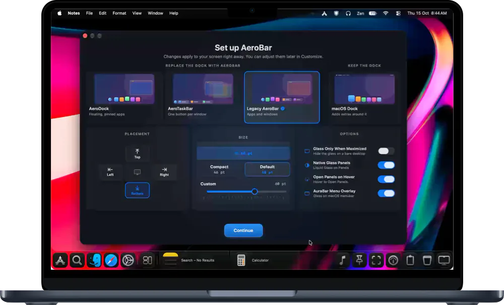
</p>

| Mode | Preview | Description |
| :--- | :---: | :--- |
| **01. macOS Dock + Extensions** | 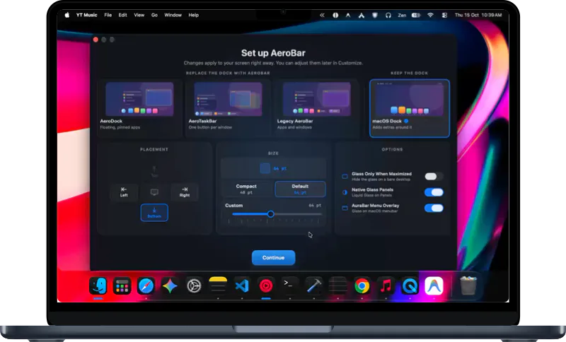 | Keeps the native macOS Dock and wraps it in a glass panel with live window previews, status extensions, and quick actions. |
| **02. AeroDock** | 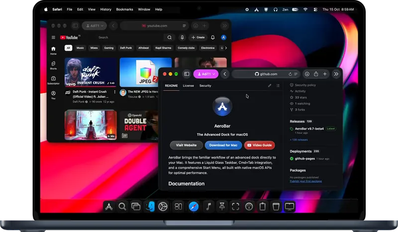 | Floating glass bar with pinned apps, active window tabs, and the Aero Orb launcher at the start. |
| **03. AeroTaskBar** | 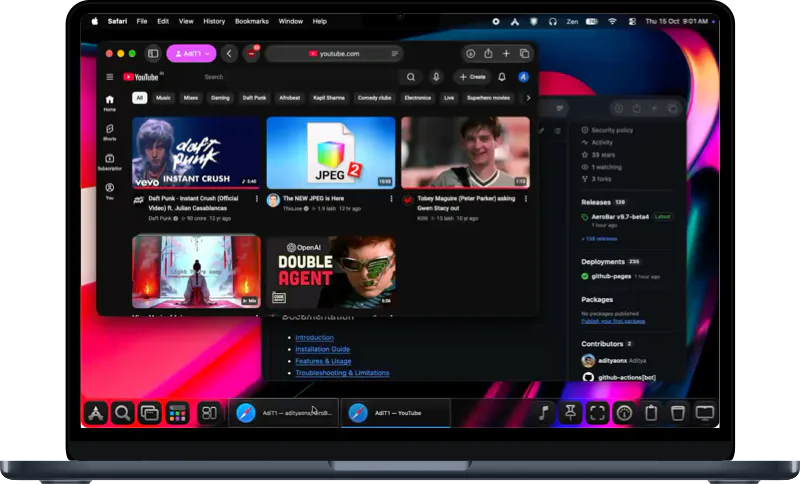 | Full-width taskbar with dedicated buttons for every open window, live thumbnail hover previews, and badge counts. |
| **04. Legacy AeroBar** |  | Unified dock combining pinned launcher applications and open window buttons in a single bar. |

---

## Features & Capabilities

### 1. Every Window, One Click Away
Open windows become live tabs in taskbar modes. Hover over any tab to view a real-time thumbnail preview with an instant close button, or press `+` to open a new window. Badge counters carry over seamlessly from macOS.

<p align="center">
  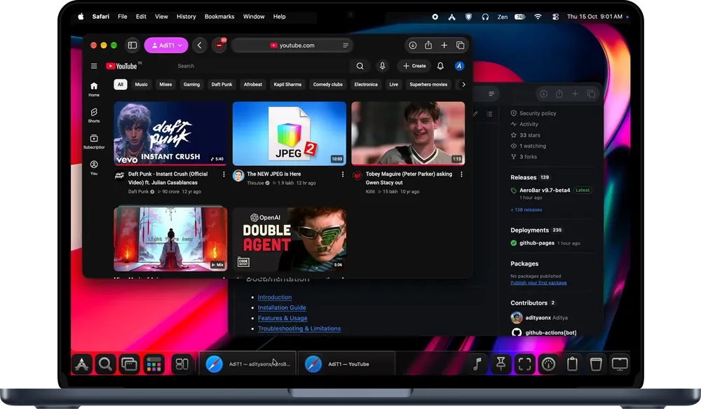
</p>

### 2. Aero Menu: A Start Menu with Real Depth
Click the Aero Orb to search applications and files, drag-to-reorder pinned favourites, access recent documents, and lock, log out, restart, or shut down directly from the menu.

<p align="center">
  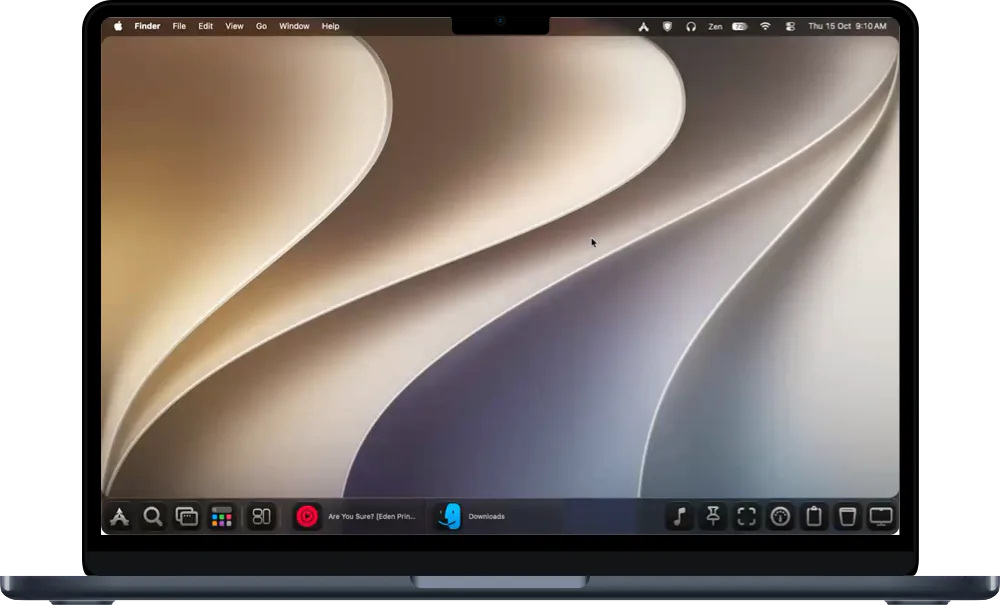
</p>

### 3. Smart Switcher (⌘Tab Rebuilt)
A completely reimagined window switcher with live window previews. Press <kbd>⌘</kbd> <kbd>Tab</kbd> to cycle between applications and <kbd>⌘</kbd> <kbd>`</kbd> to switch between windows of the active application.

<p align="center">
  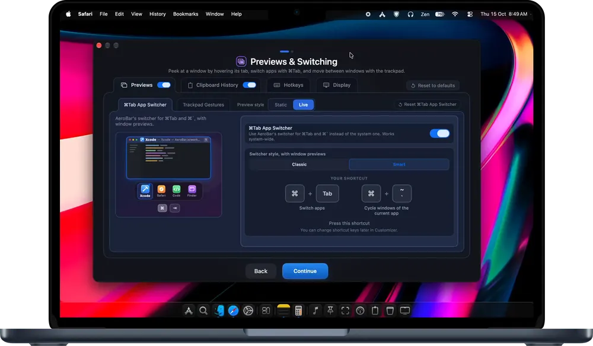
</p>

### 4. Searchable Clipboard History
Every snippet, link, and code block you copy is instantly indexed and searchable via hotkey. Includes rich previews, keyboard shortcuts, and encrypted, password-protected local backup.

<p align="center">
  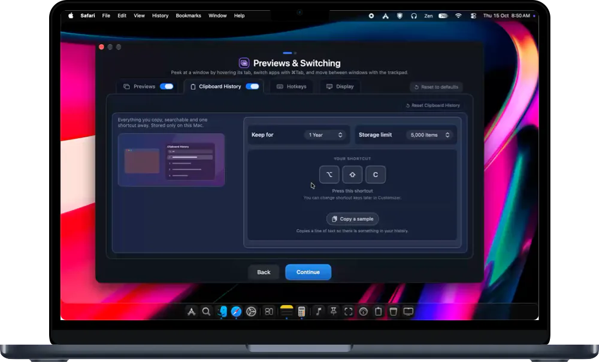
</p>

### 5. Fluid Trackpad Gestures
Swipe horizontally with three fingers across your trackpad to glide effortlessly between open AeroBar windows with responsive, physics-based animations and customizable sensitivity.

<p align="center">
  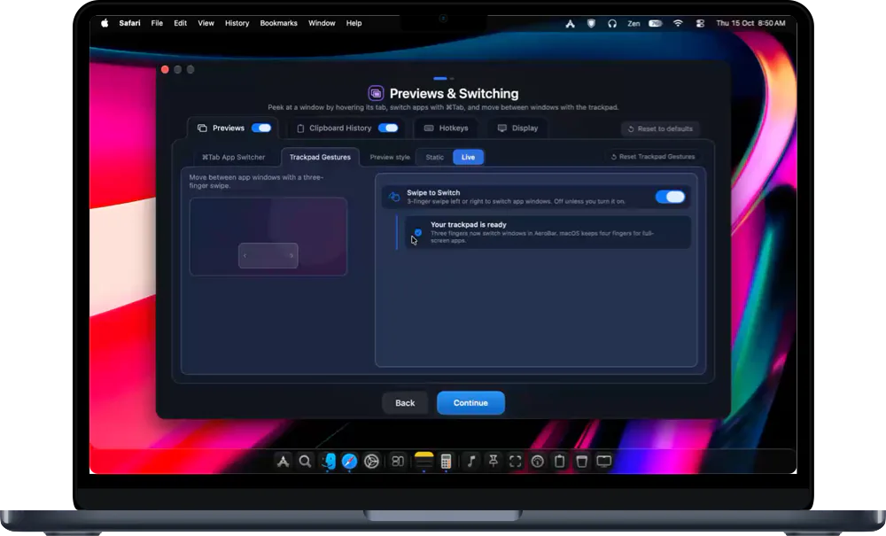
</p>

### 6. Multi-Display Support & Idle Dimmer
Run AeroBar across all connected monitors, external displays only, or your primary display. Idle screens can dim automatically to keep your focus squarely on your active work.

<p align="center">
  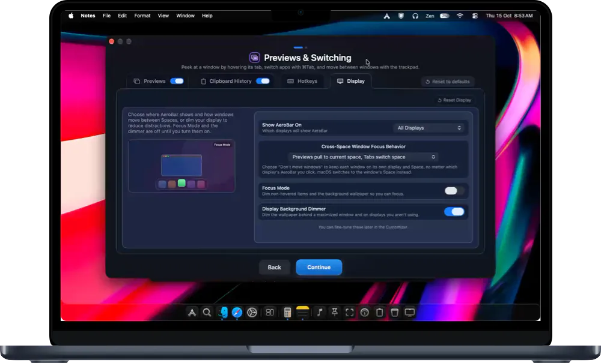
</p>

---

## Tailor Every Detail

Personalize AeroBar to match your desktop aesthetic with granular appearance controls:

| Liquid Glass & Tinting | Hover Previews & Popups |
| :---: | :---: |
| 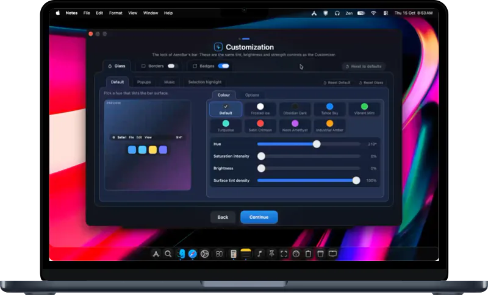<br><em>Frosted Ice, Obsidian Dark, Vibrant Mint, Satin Crimson, or dynamic auto-tinting from your active app.</em> | 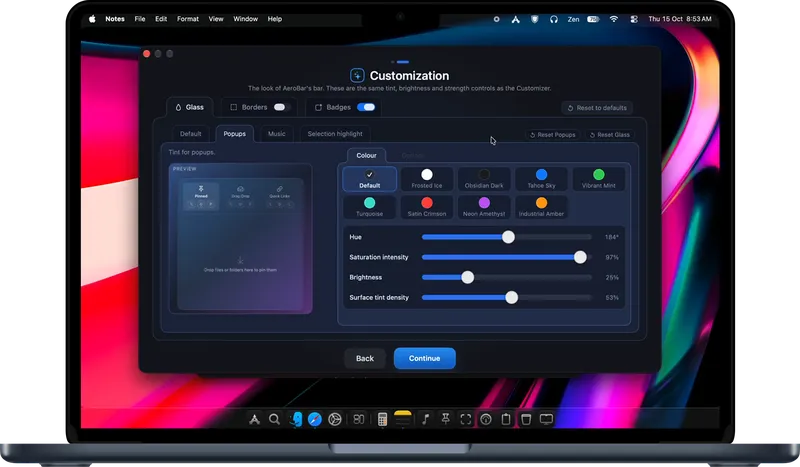<br><em>Fine-tune thumbnail preview scale, blur radius, animation curves, and response delays.</em> |
| **Music Widget Styles** | **Notification Badges & Highlights** |
| 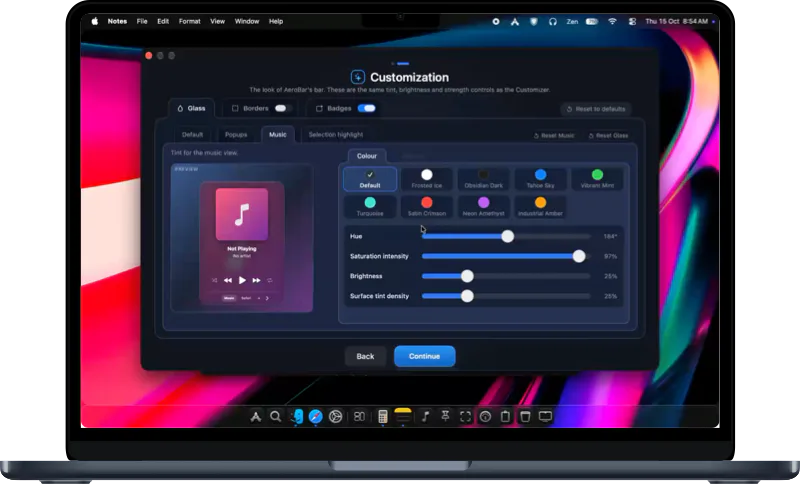<br><em>Spotify, Apple Music, and web players with album art, playback controls, and progress bars.</em> | 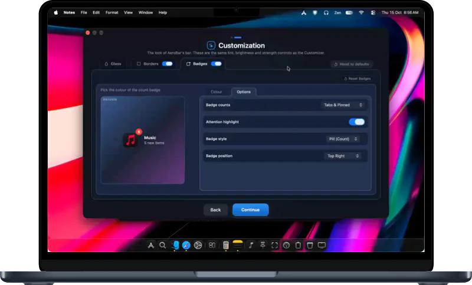<br><em>Style badge counters, unread notification dots, and dock indicators with custom colors.</em> |

---

## Installation

### Option 1: Homebrew (Recommended)

Install AeroBar using the official Homebrew tap:

```bash
brew tap adityaonx/aerobar https://github.com/adityaonx/AeroBar && brew trust adityaonx/aerobar && HOMEBREW_NO_QUARANTINE=1 brew install --cask aerobar
```

*(If macOS displays a quarantine warning on initial launch, execute: `xattr -rd com.apple.quarantine /Applications/AeroBar.app`).*

> **Update Basket Security:** Homebrew installs AeroBar; subsequent updates are delivered securely through AeroBar's built-in **Update Basket**. Download the `.dmg` and cryptographic `.sig` signature from the release page and drop both into the basket, which verifies the signature before installation. A plain `brew upgrade` skips AeroBar to prevent unsigned tampering.

---

### Option 2: Manual Download

1. Download **AeroBar.dmg** from the [Latest Releases](https://github.com/adityaonx/AeroBar/releases/latest).
2. Open the `.dmg` and drag **AeroBar.app** into your `/Applications` directory.
3. **First Launch (Gatekeeper):** Because AeroBar is self-signed:
   - **System Settings:** Launch AeroBar &rarr; Open **System Settings &rarr; Privacy & Security** &rarr; Click **Open Anyway**.
   - **Terminal Alternative:** If macOS reports the application as damaged:
     ```bash
     xattr -rd com.apple.quarantine /Applications/AeroBar.app
     ```
4. Grant **Accessibility** permissions when prompted to enable window management and thumbnail previews.

---

## Community & Contributing

AeroBar's development is driven by user feedback and community collaboration.

- [Discussions](https://github.com/adityaonx/AeroBar/discussions): Share workflow ideas, ask questions, or propose new features.
- [Issues](https://github.com/adityaonx/AeroBar/issues): Report unexpected behavior or submit bug reports.
- [Video Guide](https://www.youtube.com/watch?v=NY2qc3SOwXk): Watch the visual walkthrough on YouTube.

---

<p align="center">
  <sub>Built natively with Swift and AppKit for macOS Sonoma (14.0+) & Sequoia (15.0+). Released under the GNU General Public License v3.0.</sub>
</p>
